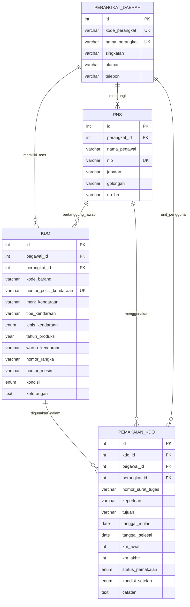

# SI-KDO BMD — Sistem Aplikasi Pengelolaan Kendaraan Dinas Operasional

Aplikasi berbasis web untuk pengelolaan data **Kendaraan Dinas Operasional (KDO)** milik **Perangkat Daerah (PD)** sebagai bagian dari tata kelola **Barang Milik Daerah (BMD)** (Kartu Inventaris Barang / KIB B). Sistem ini membantu proses inventarisasi kendaraan dinas, pemantauan kondisi fisik kendaraan (`Baik`, `Rusak Ringan`, `Rusak Berat`), pencatatan **Pegawai Negeri Sipil (PNS)** penanggung jawab, serta pencatatan **Pemakaian Operasional KDO** berdasarkan Surat Tugas / SPPD / BAST.

---

## Fitur Utama

1. **Dashboard Eksekutif BMD & KDO**:
   - Ringkasan KPI real-time (Total Aset KDO, Kondisi Baik, Rusak Ringan, Rusak Berat, Pemakaian Aktif, Total PNS, dan Total Perangkat Daerah).
   - Visualisasi proporsi kondisi fisik KDO dan peringatan kendaraan yang membutuhkan pemeliharaan/servis.
   - Tabel rekapitulasi penguasaan KDO per Perangkat Daerah (OPD/SKPD) dan log pemakaian terbaru.
2. **CRUD Kendaraan Dinas Operasional (KDO)**:
   - Mengelola Nomor Polisi (Plat Dinas), Kode Barang BMD, Merk, Tipe, Jenis (`Roda 4`, `Roda 2`, `Roda 6 / Khusus`), Tahun Produksi, Warna, Nomor Rangka (VIN), Nomor Mesin, Kondisi (`Baik`, `Rusak Ringan`, `Rusak Berat`), Perangkat Daerah pemilik, dan PNS penanggung jawab.
3. **CRUD Pegawai Negeri Sipil (PNS)**:
   - Mengelola Nama Pegawai (beserta gelar), NIP 18 digit standar BKN, Jabatan Struktural/Fungsional, Golongan Ruang (`II/a` s/d `IV/e`), Nomor Kontak Kedinasan, dan relasi ke Perangkat Daerah.
4. **CRUD Perangkat Daerah (PD)**:
   - Mengelola Organisasi Perangkat Daerah (Dinas Pendidikan, Dinas Kesehatan, Dinas Pekerjaan Umum dan Penataan Ruang (PUPR), BPKAD, Dinas Perhubungan, Dinas Lingkungan Hidup, Inspektorat Daerah, dll.) beserta Kode SKPD, Singkatan, Alamat, dan Telepon.
5. **CRUD Pemakaian KDO (Fitur Pengembangan & Relasi Operasional)**:
   - Mencatat dan menampilkan riwayat penggunaan KDO beserta PNS pengguna dan Perangkat Daerah berdasarkan Nomor Surat Tugas / SPPD / BAST, Keperluan, Tujuan, Tanggal Mulai & Selesai, Odometer (KM Awal & Akhir), Status Pemakaian (`Digunakan`, `Terjadwal`, `Selesai`), serta sinkronisasi otomatis kondisi KDO setelah pemakaian selesai.
6. **Antarmuka Modern & Aksesibel**:
   - Halaman Dashboard, Halaman List (dengan pencarian real-time & multi-filter), Halaman Detail (lengkap dengan tabel relasi), Halaman Form (Create & Update), dan Modal Konfirmasi Hapus (`<dialog>`).

---

## Tech Stack

- **Backend**: PHP 8+ (Native PHP dengan PDO Prepared Statements)
- **Arsitektur API**: RESTful API (JSON Request/Response, mendukung metode `GET`, `POST`, `PUT`, `PATCH`, `DELETE`)
- **Database**: MySQL / MariaDB (`InnoDB`, `utf8mb4`) dengan relasi Foreign Key
- **Frontend**: Semantic HTML5 (`<search>`, `<dialog closedby="any">`), Modern CSS3 (`@container` responsive tables, `:user-invalid` validation), Vanilla JavaScript (ES6+ Fetch API)
- **API Testing**: Postman Collection v2.1 (`postman/SI_KDO_BMD.postman_collection.json`)

---

## Struktur Direktori

```text
kendaraan-dinas-operasional/
├── api/
│   ├── dashboard.php          # Endpoint agregasi statistik & KPI Dashboard
│   ├── kdo.php                # Endpoint CRUD Kendaraan Dinas Operasional (KDO)
│   ├── pd.php                 # Endpoint CRUD Perangkat Daerah (PD)
│   ├── pemakaian.php          # Endpoint CRUD Pemakaian Operasional KDO
│   └── pns.php                # Endpoint CRUD Pegawai Negeri Sipil (PNS)
├── assets/
│   ├── css/
│   │   └── style.css          # Stylesheet responsif & komponen UI modern
│   └── js/
│       └── app.js             # Controller SPA, Fetch API, & validasi aksesibilitas
├── config/
│   └── db.php                 # Koneksi PDO MySQL, security headers, & helper JSON
├── database/
│   └── db_kendaraan_dinas_operasional.sql  # Dump skema RDBMS & data riil BMD
├── postman/
│   └── SI_KDO_BMD.postman_collection.json  # Koleksi pengujian Postman siap impor
├── index.php                  # Antarmuka utama aplikasi (Dashboard, List, Detail, Form)
├── AGENTS.md                  # Dokumentasi arsitektur & panduan untuk AI Agent / Developer
├── MANUAL_SETUP.md            # Panduan instalasi & konfigurasi langkah demi langkah
├── dokumentasi_latihan.md     # Dokumentasi teknis RESTful API & skenario pengujian
└── README.md                  # Dokumentasi utama proyek
```

---

## Skema Entitas & Relasi Database (`db_kendaraan_dinas_operasional`)



---

## Dokumentasi Singkat RESTful API

Base URL: `http://localhost/kendaraan-dinas-operasional`

| Endpoint | Metode | Deskripsi | Parameter Query / Body |
| :--- | :--- | :--- | :--- |
| `/api/dashboard.php` | `GET` | Mengambil statistik KPI, distribusi kondisi, rekap PD, & log terbaru | - |
| `/api/kdo.php` | `GET` | Daftar semua KDO atau detail 1 KDO (beserta riwayat pemakaian) | `?id=1`, `?search=`, `?kondisi=`, `?perangkat_id=`, `?jenis_kendaraan=` |
| `/api/kdo.php` | `POST` | Menambahkan KDO baru | JSON: `nomor_polisi_kendaraan`, `merk_kendaraan`, `tipe_kendaraan`, `tahun_produksi`, `warna_kendaraan`, `kondisi`, `pegawai_id`, `perangkat_id` |
| `/api/kdo.php` | `PUT` / `PATCH` | Memperbarui data KDO | JSON: `id` + field yang diubah |
| `/api/kdo.php` | `DELETE` | Menghapus data KDO | `?id=1` atau JSON `{"id": 1}` |
| `/api/pns.php` | `GET` | Daftar semua PNS atau detail 1 PNS (beserta daftar KDO & pemakaian) | `?id=1`, `?search=`, `?perangkat_id=`, `?golongan=` |
| `/api/pns.php` | `POST` | Menambahkan PNS baru | JSON: `nama_pegawai`, `nip`, `jabatan`, `golongan`, `perangkat_id`, `no_hp` |
| `/api/pns.php` | `PUT` / `PATCH` | Memperbarui data PNS | JSON: `id` + field yang diubah |
| `/api/pns.php` | `DELETE` | Menghapus data PNS (dicegah dengan `409 Conflict` bila masih memegang KDO) | `?id=1` atau JSON `{"id": 1}` |
| `/api/pd.php` | `GET` | Daftar semua Perangkat Daerah atau detail 1 PD | `?id=1`, `?search=` |
| `/api/pd.php` | `POST` | Menambahkan Perangkat Daerah baru | JSON: `nama_perangkat`, `kode_perangkat`, `singkatan`, `alamat`, `telepon` |
| `/api/pd.php` | `PUT` / `PATCH` | Memperbarui data Perangkat Daerah | JSON: `id` + field yang diubah |
| `/api/pd.php` | `DELETE` | Menghapus Perangkat Daerah (dicegah dengan `409 Conflict` bila masih memiliki KDO) | `?id=1` atau JSON `{"id": 1}` |
| `/api/pemakaian.php` | `GET` | Daftar semua Pemakaian KDO atau detail 1 Pemakaian | `?id=1`, `?search=`, `?status_pemakaian=`, `?perangkat_id=`, `?kdo_id=` |
| `/api/pemakaian.php` | `POST` | Mencatat pemakaian KDO baru | JSON: `kdo_id`, `pegawai_id`, `perangkat_id`, `nomor_surat_tugas`, `keperluan`, `tujuan`, `tanggal_mulai`, `km_awal`, `status_pemakaian`, `kondisi_setelah` |
| `/api/pemakaian.php` | `PUT` / `PATCH` | Memperbarui / menyelesaikan pemakaian KDO | JSON: `id` + field yang diubah |
| `/api/pemakaian.php` | `DELETE` | Menghapus catatan pemakaian KDO | `?id=1` atau JSON `{"id": 1}` |

---

## Panduan Cepat Menjalankan Aplikasi

Lihat panduan lengkap pada [MANUAL_SETUP.md](file:///c:/xampp/htdocs/kendaraan-dinas-operasional/MANUAL_SETUP.md). Secara ringkas:

1. Pastikan layanan **Apache** dan **MySQL** pada XAMPP sudah berjalan.
2. Impor file database `database/db_kendaraan_dinas_operasional.sql` ke MySQL / phpMyAdmin.
3. Buka aplikasi melalui browser di `http://localhost/kendaraan-dinas-operasional/`.
4. Untuk menguji RESTful API di Postman, impor file `postman/SI_KDO_BMD.postman_collection.json`.
